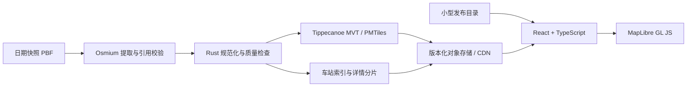

# 技术架构 · v1.0

状态：当前阶段实施基线。覆盖沈阳 → 东北 → 全国；实测边界见 [可行性报告](feasibility.md)。
当前实现为提取脚本、Rust 数据探针与浏览器探针；下列生产契约尚待按实施计划实现。

## 1. 总体方案

**离线构建、版本化静态数据、浏览器按需渲染。** Rust 承担后台数据计算，
首版无需常驻业务服务器。全国扩展沿用瓦片契约，在动态查询超过静态方案预算时增加 Rust API。



已验证城市级的提取、PBF 读取、几何转换、瓦片生成与浏览器 Range 读取。
尚未验证全国吞吐量、线上 CDN、目标手机、正式底图与运营线路关系闭包。

## 2. 技术选型

| 部分 | 采用 | 依据及边界 |
| --- | --- | --- |
| 产品前端 | TypeScript + React + Vite | 管理搜索、筛选、详情、URL；当前探针是原生 JS，尚未建立正式组件 |
| 地图 | MapLibre GL JS，验证 6.15.0 | GeoJSON/MVT 与渲染查询；ESM、worker、字体、sprite、CSP 需构建检查 |
| 提取 | Osmium Tool，验证 1.16.0 | complete_ways 保留几何引用；relation 完整性另验 |
| 计算 | Rust CLI，rustc 1.90.0、osmpbfreader 0.19.1 | 规范化、几何与质检；当前探针只用于已裁剪区域 |
| 瓦片 | Tippecanoe 2.49.0，MVT/PMTiles v3 | 分级渲染；探针无限制参数不能直接用于全国 |
| 浏览器读取 | pmtiles JS，验证 4.5.0 | Range 读取；依赖正确缓存、CORS 与不可变 URL |
| 数据库 | v1 无运行时数据库 | 离线生成数据；空间动态查询/编辑进入范围后评估 PostGIS |
| API | v1 静态资源；未来 Rust Axum | 全国索引超预算、动态查询进入范围时引入 |
| WASM | v1 不引入 | 地图 worker 与瓦片先解决已知问题；按实测计算瓶颈触发 |

依赖版本记录的是已验证组合，不声称永久最佳。升级锁文件后重跑领域、构建和地图回归。
MapLibre 旧版依赖审计发现已知漏洞，验证前已升级；见 [证据](feasibility.md)。

## 3. 数据流水线

1. 获取日期快照，记录 URL、源数据时间、抓取时间、大小、SHA-256 与上游可用校验文件。
   首次计算指纹用于锁定重跑，不等价于验证上游真实性。
2. 使用版本化 WGS84 bbox/polygon 区域配置、complete_ways 提取。
   几何可延伸出范围，查询范围与展示覆盖分开记录。多区域构建避免逐区反复扫描全国原始文件。
3. 过滤 railway 与指定生命周期标签，保留引用；不使用 omit-referenced。
4. way→node 缺失必须为 0；relation 闭包独立报告，失败批次不发布。
5. Rust 规范化身份、对象类型、几何、制式、生命周期、展示属性、原标签与来源。
6. 派生轨道/站点/设施瓦片、车站索引、详情分片、覆盖轮廓与 manifest。
7. 质量、性能、署名、坐标与发布条件检查通过后上传不可变版本。
8. 校验全部文件，再原子更新 current 指针；保留当前和上一版本，回滚只切指针。

Overpass 只用于小型探索，不作为全国生产作业或访问端的实时上游。
本次样本包含 railway node/way 与节点引用，没有 route relation，不能替代全国 PBF 吞吐量实验。

## 4. 领域模型

| 实体 | 核心字段 | 语义 |
| --- | --- | --- |
| Snapshot | id、source_time、source_url、input_sha256、tools、rules_version、coverage | 所有派生物绑定同一版本；抓取时间与源时间分开 |
| RailFeature | feature_key、osm_type、osm_id、geometry、feature_kind、rail_mode、lifecycle、source_tags、snapshot_id | typed key 如 node/123；源身份稳定，展示片段不替代实体身份 |
| StationRecord | feature_key、name、aliases、mode、anchor、bounds、links | 每个源站点/站区独立，未核验不合并 |
| StationGroup（后续） | group_id、member_keys、evidence、review_status | relation/明确引用优先；距离和同名仅作为候选 |
| RailwayRoute（后续） | route_id、members、name、completeness | 运营线路与轨道片段分离，不按 way 名称直接拼线路 |

正式枚举：

- feature_kind：track / station_point / station_area / platform / stop_position / entrance / facility / unknown。
- rail_mode：rail / subway / light_rail / tram / other / unknown。
- lifecycle：mapped / construction / proposed / disused / abandoned / razed / unknown / conflict。

显式生命周期前缀和 railway 值共同参与分类；相互矛盾时置 conflict 并保留原标签。
车站无明确制式时为 unknown，不能仅因未标 subway 就归国铁。
mapped 表示 OSM 当前记录，不保证运营。高铁、service、usage 保持独立可追溯属性。
当前探针只实现基本生命周期与属性保留，正式枚举、冲突检测与 station 面几何尚未实现。

ID 在 JSON、URL、详情中用字符串，避免 JavaScript 精度与 node/way 同号冲突。
MVT 内建整数 ID 不承载 typed ID；保留字符串 feature_key，通过 promoteId 使用。
探针用属性 osm_id，正式 schema v1 统一为 feature_key，迁移要明确版本。

## 5. 几何与瓦片

源数据保持 WGS84，GeoJSON 经度在前。渲染投影与底图坐标适配独立实现；
如采用其他坐标体系，须记录变换依据并用锚点测误差，不覆盖原始坐标。
本次纯色背景不能证明外部底图对齐或授权。
下载文件的地理覆盖不自动构成产品行政边界定义；全国背景与行政界线需使用另行确认的合法来源。

正式 source layers 为 rail_tracks、rail_stations、rail_facilities；共有字段为
feature_key、feature_kind、name、rail_mode、lifecycle、snapshot_id。
轨道附带有限 usage/service/highspeed，完整 tags 放详情分片。
站区保留面，代表点单独生成并注明算法，不把 station way 当铁路轨道绘制。

全国概览 z4–7，区域城市 z8–14；高缩放是否追加 z15–16 以站场精度验收决定。
低缩放显式过滤侧线与设施，不能靠随机丢掉必要轨道满足预算。
跨 tile 结果按 feature_key 去重，高亮不依赖 tile 内序号。
跨区域按 typed ID 与同一 snapshot 去重，使用缓冲重建边界；不无提示拼接不同快照。

## 6. 静态资源契约

```text
/catalog/current.json
/snapshots/{id}/manifest.json
/snapshots/{id}/{region}/railway.pmtiles
/snapshots/{id}/{region}/stations.json
/snapshots/{id}/{region}/details/{shard}.json
/snapshots/{id}/{region}/coverage.geojson
```

manifest 字段：schema_version、snapshot_id、source_time、rules_version、coverage、
文件 URL/bytes/sha256、source layers、zoom、attribution、license。
目录只引用已通过的版本；immutable 资源不使用 latest 覆盖。

详情按 feature_key UTF-8 字节的 SHA-256 前两位十六进制分为 256 桶，桶内键为 feature_key。
桶 gzip >256 KiB 时增加散列位数，并在 manifest 标明规则。
缓存按快照隔离，详情分片按点击懒加载。

车站索引仅存 name、aliases、feature_key、mode、anchor、region、feature_kind。
在 worker 中索引中文名称：精确→别名→子串。“站”后缀只辅助匹配，不合并身份。
首版搜索范围明确为当前可用区域；全国阶段若全局索引 gzip >2 MiB 或搜索 p95 >300 ms，
采用版本化 Rust 查询 API，避免浏览器下载全国完整索引：

```text
GET /v1/search?q=沈阳北&region=cn&snapshot={id}&limit=20
GET /v1/features/{typed-key}?snapshot={id}
```

限制参数长度、limit、区域、快照；响应附版本和稳定 ID。v1 不提前建设该 API。

## 7. 前端模块与状态

MapView 管地图实例；SearchPanel、LayerPanel、FeatureDrawer、DatasetInfo 管产品内容；
DatasetClient 解析版本目录；UrlState 校验/恢复分享链接。
React 管面板、筛选和选中状态；高频平移留在地图实例，moveend 更新 URL，避免逐帧全界面重绘。
切区使用请求代次/AbortController，迟到结果不覆盖新状态；详情、索引、瓦片、底图错误独立处理。

全国入口只请求视野相关瓦片、当前索引与点击详情。
探针为方便消歧和详情仍预载整份 GeoJSON，因此 PMTiles 切换耗时不等于生产冷启动。

## 8. Rust 资源策略与 WASM

get_objs_and_deps 将依赖对象放内存，当前仅用于裁剪后的城市。
全国构建先批量裁剪并逐块处理，或实现磁盘索引/多遍流式处理；必须测峰值 RAM/磁盘与失败恢复。
正式 CLI 增加指纹、规则版本、内存预算、结构化报告和非零失败码。
不能将本次 0.14 秒城市转换线性外推全国。

WASM 仅在浏览器确需本地拓扑/大量几何计算，且 worker 任务持续 >50 ms、交互 p95 >100 ms 时评估。
先排除多余传输、主线程更新和图层过多；比较 TS worker 与 Rust/WASM 的加载、复制、体积与计算总成本。
普通筛选、全国 PBF 解析和瓦片服务不迁入 WASM。

## 9. 发布与运维

初始月度人工触发快照，不承诺实时更新。
流程为获取→锁定→构建→质检→暂存→文件校验→切指针；失败输出隔离，不能更新 current。
CI 检查 Rust 领域测试、Python 入口、前端构建/交互、依赖审计和大文件。
全国作业使用有资源预算的构建环境，不假设普通 CI runner 足够。

PMTiles 端点必须返回 206、Content-Range、Accept-Ranges；跨域配置允许来源和所需响应头。
缓存不能混淆字节范围；不对整份 archive 透明 gzip 破坏偏移。
不可变文件长缓存，current 短缓存；发布与前端部署可以独立回滚。

成本由对象存储、请求、CDN 流量与离线构建构成，以实测体积×访问量×当期服务商单价核算。
本次城市包不能估算全国总成本；本次未购买服务或公开部署。
观测首屏、瓦片错误/延迟、搜索 p95、长任务、资源字节、构建耗时/峰值内存与分类缺失率。
默认本地测量；线上遥测需要单独确定隐私与采样策略。

## 10. 许可与公开地图条件

OSM 数据遵循 ODbL，代码许可证单独选择。不能从未知许可地图抄录数据。
OpenRailwayMap 是同类参照，其 GPL 代码和现成服务不作为无条件可复用资产。
正式发布前核实底图许可、坐标对齐、覆盖与适用的地图审核/备案事项，
由负责人按主体和场景确认；本机验证不代表具备上线条件。
参考 [OSM 版权](https://www.openstreetmap.org/copyright) 与
[自然资源部/工信部相关通知](https://gdca.miit.gov.cn/xwdt/xydt/art/2024/art_b58ad486b6f244c18e31877a5b3391e1.html)。

## 11. 决策记录

| 决策 | 采用 | 重新评估条件 |
| --- | --- | --- |
| ADR01 | 静态数据先行 | 需要动态查询或全局索引超预算 |
| ADR02 | Rust 离线计算 | 保持模型/报告一致，达到全国资源门槛 |
| ADR03 | 地理片段优先 | 具备完整 relation 与拓扑验收后建设运营线路 |
| ADR04 | 全国瓦片+分片索引 | CDN Range 与全国数据实测通过 |
| ADR05 | WASM 暂缓 | 达到上述浏览器重计算触发条件 |
| ADR06 | 不可变版本发布 | 保留存储换取可追溯、分享和回滚 |

具体阶段门槛见 [实施与验收计划](implementation-plan.md)。
