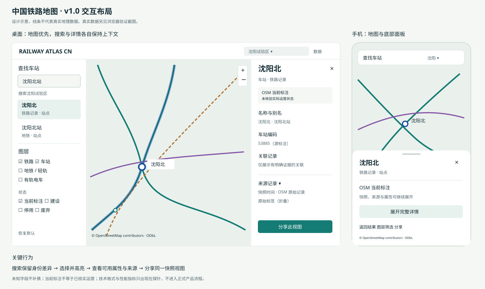

# 交互与视觉设计 · v1.0

状态：供正式产品实施的设计基线。需求对应 [R01–R12](requirements.md)。
本机探针是技术验证，含格式切换与性能读数；正式界面不暴露这些实现细节。

## 1. 设计原则

地图是主内容；搜索与筛选帮助用户理解真实铁路空间。轻量底图降低干扰，
轨道、车站与选中对象具有清晰层级。显式标注未知和覆盖范围，不用空白地图暗示数据不存在。

信息先后顺序：我在看哪里 → 想找什么 → 这是什么 → 数据从哪里来。
不在首屏要求用户理解 OSM、PBF、WASM、PMTiles 或后端结构。

## 2. 页面与布局

只有两个一级页面：`地图` 与 `关于数据`。分享链接直接回到地图状态。

桌面 ≥960 px：顶部 56 px 标题与区域切换；左侧 320 px 搜索与筛选，地图填满余下空间；
详情在右侧 360 px 抽屉打开，地图重新计算可见范围，选中对象不被面板遮住。
面板各自滚动，地图署名固定可访问；搜索结果区最多显示 6 行后滚动。

平板 600–959 px：左侧面板可收起；详情替换面板内容，保留“返回搜索结果”。
手机 <600 px：顶部搜索与区域按钮，地图全屏；底部面板有 72 px 摘要、45% 列表、85% 详情三档。
可用按钮切换档位，不强制依赖拖动手势；地图上保留复位、缩放与署名入口。

示意图中的轨道仅表示布局。真实数据截图见 [技术探针](evidence/pilot-browser.png)。

## 3. 默认地图状态

首次进入沈阳可用范围，显示“沈阳试验区 · 数据截至 {source_time}”。
默认启用铁路与车站；城轨、设施、非当前状态在图层面板明确开关。
低缩放显示概览与主要站点；放大后增加侧线、站台和轨道设施。
选中态为高对比外描边；不改变要素原本表示类型的颜色。

| 缩放层级（初始规则，按 QA 调整） | 轨道与标注 |
| --- | --- |
| z4–7，全国阶段 | 概览主干与少量大站；不画信号、道岔和站场侧线 |
| z8–11，区域 | 铁路/城轨网络与车站；主线优先，侧线抑制 |
| z12–14，城区 | 轨道细节、站点，显示已选图层中的站场与生命周期 |
| z15–18，站场 | 设施、站台、道岔；高缩放复用 z14/更高精度数据策略由瓦片验收确定 |

无 `service` / `usage` 标签时仍显示轨道，不把“未知”作为过滤主线的反向证据。

## 4. 搜索流程

输入 → 200 ms 防抖 → 本区域名称/别名匹配 → 结果 → 定位与详情。
输入法组合期间不查询；键盘上下选择、Enter 打开、Esc 清空或关闭当前层。
优先精确名称，其次别名，再子串；“站”后缀仅用于候选匹配，不作为实体合并依据。
地域范围显示在搜索框下：`搜索沈阳试验区`，全国阶段支持显式切换范围。

每个结果显示：名称、铁路/地铁/未知制式、区域、站点/站区类别；名称相同也保留多个候选。
产品默认不把技术 ID 放在结果主行，详情的“来源记录”中可查看。
例如“沈阳”铁路记录和“沈阳站”地铁记录均可点击，不能把后者当成前者的别名自动合并。

点击结果 → 保留列表与查询 → 地图定位 → 对象高亮 → 抽屉显示详情。
返回列表恢复滚动位置；后续输入取消旧请求，迟到结果不能覆盖新查询。

## 5. 图层与筛选

采用两个独立分组：

- 类型：铁路、地铁/轻轨、有轨电车、其他轨道、制式未知。
- 状态：OSM 当前标注、建设、规划、停用、废弃/拆除、状态未知/冲突。

“设施细节”单独开关，只在适当缩放层级显示。提供“恢复默认”。
图例随当前类型和状态更新，结果计数表述为“当前视野可见记录”，不当作线路或车站总量。
图层筛选应同时影响相关轨道和已明确制式的站点；未知制式站点由独立开关控制。
全部关闭时说明“当前没有启用的图层”，保留地图与恢复按钮。

## 6. 详情抽屉

顺序为名称 → 类型与状态 → 可用关键属性 → 数据说明 → 来源记录。

轨道：名称、service/usage、显式高铁标签、限速、电气化、轨距、桥隧、运营方。
车站：名称/别名、制式、站点或站区、车站编码（若有）、可确认的关联对象。
未知显示“未标注”；不适用字段不展示；冲突字段展示原始标注并解释冲突。
运营线路关系未建立时显示“尚未建立完整线路关联”，不能暗示没有线路经过。

来源区：数据快照、源对象更新时间（有则显示，两者分开）、typed OSM ID、
OSM 原始页面、规则版本、当前覆盖范围。原始标签默认折叠。
OSM 标签与名称全部以文本节点渲染；外链不得直接执行标签内容。

## 7. 视觉规范

背景暖白 `#F5F7F4`，主文字 `#172E37`，次文字 `#526770`，边界 `#D8E1DE`。
铁路用深青 `#147C74`，城轨用紫 `#8657A6`；选中描边深蓝 `#154E9D`。
建设用橙色与短虚线，停用用灰色长虚线，废弃用棕色点划线；必须同时使用形状/图例文字，不能只靠颜色辨识。
高铁强调来自显式分类数据，采用双线/外描边而非凭名称变色。

正文字号 14–16 px，正文行高 ≥1.5；控件触摸目标 ≥44×44 px；圆角 8 px。
主要文字与背景达到 WCAG AA 对比目标（普通文字 ≥4.5:1）。上线前用实测色值检查，
此处颜色为设计值，不替代对比度验证。焦点环 2 px，不能被面板裁切。

## 8. 状态设计

| 状态 | 用户看到的内容 | 可执行动作 |
| --- | --- | --- |
| 加载 | 当前区域与轻量骨架；保留已有图层 | 等待/取消区域切换 |
| 覆盖外 | “当前数据未覆盖此处”与覆盖轮廓 | 回到沈阳/选择可用区域 |
| 缩放不足 | “放大查看站场设施” | 放大 |
| 搜索无结果 | “当前区域没有匹配记录”，保留输入 | 修改关键词/切换区域 |
| 筛选无结果 | 当前启用类型与状态摘要 | 恢复默认 |
| 瓦片失败 | 显示已加载部分与失败提示，不抹掉地图 | 重试 |
| 旧快照不可用 | 解释分享链接所用版本已过保留期 | 打开最新版本并重新定位 |
| WebGL 不支持 | 说明浏览器能力不足，显示可用车站列表与来源页 | 使用列表/更换浏览器 |
| 坐标或数据异常 | 要素详情注明待核验，不伪装修复 | 查看来源 |

## 9. 分享与恢复

URL 结构固定为 `/?region=shenyang&snapshot={id}&feature=node%2F6179162407&types=rail&states=mapped#map=14/41.8/123.4`。
解析时校验区域、版本、类型白名单、缩放和经纬度范围。无效参数回落默认并提示。
旧要素不存在时保留视图并说明“该记录不在此快照”，不能自动选中同名实体。

## 10. 设计验收

执行 R01–R12 的交互用例，另覆盖 1440×900、1280×720、768×1024、390×844。
核对抽屉遮挡、键盘焦点、中文输入法、长名称、未知属性、网络中断、同名站点与版本恢复。
当前探针已证明地图/搜索/详情/格式切换可用；生产布局、完整状态、颜色与移动端仍须按此规格实现和验收。
