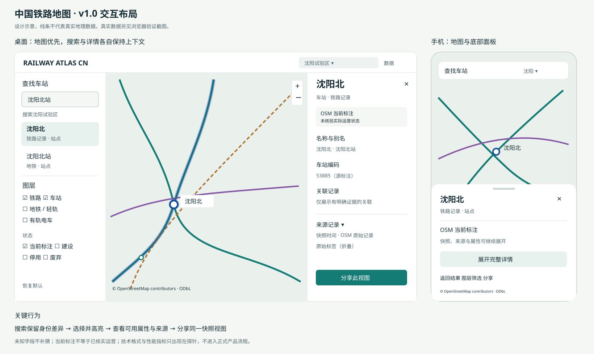

# 交互与视觉设计 · v1.3

状态：供正式产品实施的设计基线。需求对应 [R01–R18](requirements.md)，
数据范围见需求 §3.1，线路配色见 [线路配色](line-colors.md)，可访问性目标见 N09。
本机探针是技术验证，含格式切换与性能读数；正式界面不暴露这些实现细节。

## 1. 设计原则

地图是主内容；搜索与筛选帮助用户理解真实铁路空间。轻量底图降低干扰，
轨道、车站与选中对象具有清晰层级。显式标注未知和覆盖范围，不用空白地图暗示数据不存在。

信息先后顺序：我在看哪里 → 想找什么 → 这是什么 → 数据从哪里来。
不在首屏要求用户理解 OSM、PBF、WASM、PMTiles 或后端结构。

## 2. 页面与布局

只有两个一级页面：`地图` 与 `关于数据`。分享链接直接回到地图状态。

桌面 ≥960 px：顶部 56 px 标题与区域切换；左侧 320 px 搜索与筛选，地图填满余下空间；
详情在右侧 360 px 抽屉打开，地图重新计算可见范围，选中对象不被面板遮住。
面板各自滚动，地图署名固定可访问；搜索结果区最多显示 6 行后滚动。

平板 600–959 px：左侧面板可收起；详情替换面板内容，保留“返回搜索结果”。
手机 <600 px：顶部搜索与区域按钮，地图全屏；底部面板有 72 px 摘要、45% 列表、85% 详情三档。
可用按钮切换档位，不强制依赖拖动手势；地图上保留复位、缩放与署名入口。
图例与线路列表在移动端放入可折叠的图层面板，不遮挡署名、复位和缩放按钮。
正式验收覆盖桌面 Chrome/Edge/Firefox/Safari 最近两个稳定版、Android Chrome、iOS Safari 与平板；
平板沿用 600–959 px 布局，不单独设计第三套导航。

示意图中的轨道仅表示布局。真实数据截图见 [技术探针](evidence/pilot-browser.png)。

## 3. 默认地图状态

首次进入沈阳可用范围，显示“沈阳试验区 · 数据截至 {source_time}”。
默认启用铁路与车站；城轨、设施、非当前状态在图层面板明确开关。
低缩放显示概览与主要站点；放大后增加侧线、站台和轨道设施。
复位恢复当前区域默认视图，不改变筛选与查询，清除选中态。
选中态为高对比外描边；不改变要素原本表示类型的颜色。

| 缩放层级（初始规则，按 QA 调整） | 轨道与标注 |
| --- | --- |
| z4–7，全国阶段 | 概览主干与少量大站；按铁路等级配色（高速红、普速蓝、其他灰）；支线、专用线、站场侧线不显示；不画信号、道岔、站台和设施 |
| z8–11，区域 | 铁路/城轨网络与车站；铁路按等级色、地铁按线路色；显示有来源的主要线路名、主要车站名称；干线优先，支线/专用线用细线，侧线抑制；不显示设施细节 |
| z12–14，城区 | 轨道细节、支线/站场线、站点、站区及 z14+ 的站台、机务段/车辆段/检修库/水塔等面状设施（须开启设施细节）；增加一般车站名称、铁路线路名与地铁线路号标签，显示已选生命周期 |
| z15–18，站场 | stop_position、出入口、信号、道岔、平交道口、车挡、转车盘/扇形库等点状设施；显示线路号、共线标记与高缩放线路标签 |

设施细节默认关闭；“设施细节”开关不得隐藏必要轨道与车站。
桥隧作为轨道属性显示，不单独画线。高铁按已确定的等级规则显示红色线/白色 casing，不作为类型筛选。
无 `service` / `usage` 标签时仍显示轨道，不把“未知”作为过滤主线的反向证据。
线路色来源、共线回退与生命周期叠加规则见 [线路配色](line-colors.md) 与 §5.1。

### 3.1 线路名与车站标注

线路名沿轨道方向排布并保持正向可读，不在急弯、短片段上强行折字。
区域级 z8–11 就显示有可靠名称的主要铁路；z12+ 增加普通线路与地铁线路号。
名称优先使用已核验归属的基础设施线路关系名称；其次使用轨道自身的
`name:zh` / `name`。列车服务或开行交路的 route 名称不能直接充当基础设施线路名。
只有 way 名时只标该片段，不据此拼出整条线路；无名称时不在地图重复铺“未命名”，详情仍说明缺失。

车站点采用白底深色描边圆点并配名称，城轨站用较小圆点和制式/线路号辅助识别；
同名铁路站与地铁站在空间接近时分别附“铁路”“地铁”，不因同名合并。
z4–7 仅显示经过显式配置的概览站点；z8–11 显示区域重点站，z12+ 逐步增加普通站。
概览优先级来自版本化名单/规则，不按名称长度、轨道数量猜测客流或站级；
没有优先级数据时按稳定键参与避让，并记录该限制。
仅有站区面时使用注明算法的代表点，已确认关联的站点/站区只绘一份名称；
未确认关联保持独立可选，不能靠名称去重隐藏记录。

初始排版参数：站名 13–15 px、线路名 12–14 px，深色文字加 1.5–2 px 暖白描边；
地铁线路号用有深色边框的徽标。文字与实际底色对比至少 4.5:1。
标签优先级为选中对象 > 搜索聚焦对象 > 已配置重点站 > 一般站 > 线路名 > 设施名；
设施名仅在开启设施细节时显示。允许隐藏低优先级标签，不允许文字相互覆盖。
选中对象名称被遮挡时移至可见锚点/详情摘要，不能强开文字重叠。
同一已确认线路或同一源 way 的相邻片段按显示键与空间距离抑制重复标签，
初始重复间距 300 CSS px、标签间距至少 8 CSS px；不能只按同名合并不同线路。
跨瓦片接缝与双线并行区也执行同样规则；稳定键排序减少平移时标签跳动。
选中高亮线绘在普通线之上、车站和文字之下，不盖住站名。
地图缩放比例尺常驻；按钮提供“回到沈阳试验区”，与“恢复默认图层”分开。
字体缺字/加载失败时提示并保留地图，禁止默默显示方框；字体来源与许可纳入发布清单。

### 3.2 可隐藏底图

右上方常驻“显示底图”独立开关，默认开启淡化底图；记住本机选择，隐藏后刷新不发起底图请求。
关闭只恢复纯色背景，不隐藏轨道、线路名、车站与站名，不改变相机、筛选、搜索或详情。
“恢复默认图层”与预设撤销不覆盖底图偏好。移动端开关触摸目标至少 44×44 px。
底图独立错误/超时提示与重试，失败保留铁路及全部基本操作。
署名始终可访问；“关于数据”说明底图域名、请求信息与在线底图和铁路快照的时间差异。
本机实现与来源见 [第二批预览](basemap-preview.md)；公开发布仍按既有门槛验收。

## 4. 搜索流程

输入 → 200 ms 防抖 → 本区域名称/别名匹配 → 结果 → 聚焦与详情。
空/纯空白输入不查询，结果区不列出全部车站；输入法组合期间不查询；
键盘上下选择、Enter 打开、Esc 清空或关闭当前层。
优先精确名称，其次别名，再子串；“站”后缀仅用于候选匹配，不作为实体合并依据。
别名来源、归一化与排序按需求 §3.2；v1 不做拼音/繁简转换。
地域范围显示在搜索框下：`搜索沈阳试验区`，全国阶段支持显式切换范围。
搜索不受当前筛选限制；被筛选隐藏的结果标注“当前筛选已隐藏”，并提供“显示此结果”。
该动作只临时显示/高亮此对象，保留既有筛选；详情关闭后恢复，另提供明确的“恢复默认图层”。

每个结果显示：名称、铁路/地铁/未知制式、区域、站点/站区类别；名称相同也保留多个候选。
返回超过 20 条时显示“结果过多，请收窄”，面板仍只显示 6 行并可滚动。
产品默认不把技术 ID 放在结果主行，详情的“来源记录”中可查看。
命名设施 v1 不进入搜索索引，可通过地图选择查看详情；后续加入须扩展 R02/R03。
线路色和线路号只用于地图识别，v1 不做按线路名搜索；后续加入须另立需求。
例如“沈阳”铁路记录和“沈阳站”地铁记录均可点击，不能把后者当成前者的别名自动合并。

点击结果 → 保留列表与查询 → 地图聚焦 → 对象高亮 → 抽屉显示详情。
返回列表恢复滚动位置；后续输入取消旧请求，迟到结果不能覆盖新查询。

## 5. 图层与筛选

首屏展示“铁路 / 城轨 / 设施细节”入口、常用预设和当前筛选摘要；
“更多筛选”展开以下五个分组，不同时铺开所有选项：

- 类型：铁路、地铁/轻轨、有轨电车、其他轨道、制式未知。
- 铁路等级：高速铁路、普速干线、普速/未标注、支线/站场线、专用线。
- 城市轨道线路：按城市/运营方列出线路色块、线路号与可见性开关；每条可独立开关，
  详情提供“仅看此线”。
- 状态：OSM 当前标注、建设、规划、停用、废弃、拆除、状态未知、状态冲突。
- 设施细节：站台、stop_position、出入口、信号、道岔、平交道口、车挡、
  机务段/车辆段/检修库/水塔/转车盘/扇形库等，按缩放分级显示。

快捷预设：铁路概览、仅高速、仅普速、仅地铁；生命周期另提供“当前标注”“含建设/规划”。
不使用“仅当前运营”文案；当前标注不保证运营。仅普速包含 conventional_main 与 conventional_other，
支线/专用线可在更多筛选中追加。“铁路概览”恢复首次进入的默认图层。
预设对受影响的类型/等级/线路/状态一次性设定并显示摘要，不能因先前隐藏铁路而得到空的“仅高速”。
切换前保存一份筛选状态并提供“撤销”；地图视野与搜索输入不变。
不同分组间为 AND，同分组内为 OR；没有选择时明确提示，不把全关解释成全选。
车站没有线路等级证据时仍显示，附“未按线路等级筛选”，不能把未标注站点推成高铁站。
高铁是等级/属性，不作为制式筛选。设施细节为独立总开关；类型/状态/等级筛选仅作用于
有明确属性的设施，未知不因筛选静默隐藏。
图例随当前类型、等级、线路和状态更新；线路图例显示色块、线路号、来源提示，
点击图例可开关，线路列表提供“仅看此线”。结果计数表述为“当前视野可见记录”，
不当作线路或车站总量。全部关闭时说明“当前没有启用的图层”，保留地图与恢复按钮。
线路色、共线回退、浅色 casing 与生命周期叠加规则见 §5.1。

### 5.1 线路等级与配色

铁路按等级配色，城市轨道按线路身份配色；配色源为
[`config/line-colors.json`](../config/line-colors.json)，前端匹配 `line_key`，不写入瓦片。

| 显示等级 | 颜色 | 线宽 | 说明 |
| --- | --- | --- | --- |
| 高速铁路 | `#C8102E` | 3.4 | 显式高速标注；红色 + 白色 casing |
| 普速干线 | `#1F5A8A` | 2.8 | 显式 `usage=main` |
| 普速/未标注 | `#4F7FA6` | 2.2 | 不宣称具体等级 |
| 支线/站场线 | `#A17A3F` | 1.8 | 侧线高缩放显示 |
| 专用线 | `#6B4F3A` | 1.6 | 不推断产权/运营方 |
| 地铁（未识别线路） | `#8657A6` | 3.0 | 线路色缺失/共线回退 |
| 轻轨 | `#A45BB5` | 2.8 | 制式回退 |
| 有轨电车 | `#2E8B57` | 2.4 | 制式回退 |
| 其他/未知 | `#8A8F98` | 1.4 | 不强行归类 |

沈阳地铁线路色（运营方线路图取色，非官方标准色值）：

| 线路 | 色值 | 线路 | 色值 |
| --- | --- | --- | --- |
| 1号线 | `#E5001C` | 2号线 | `#F08439` |
| 3号线 | `#E6669F` | 4号线 | `#6E3E94` |
| 9号线 | `#0095D2` | 10号线 | `#8CBB48` |

颜色优先级：人工覆盖 > 运营方/线路配置 > OSM `colour` > 制式/等级回退。
每条线路显示颜色来源与置信度；沈阳地铁标注“运营方线路图”，不得写成“官方色值”。
共线段只在唯一归属明确时使用线路色；多线路共享时用制式回退色并显示“共线”，
详情列出全部线路，不取第一条 relation 冒充唯一线路。

生命周期用线型叠加：当前实线、建设短虚线、规划点线、停用/废弃/拆除中性色；
选中态用深蓝 `#154E9D` 外描边 + 白色 halo，不替换线路色。
浅色线路（2/3/10 号线等）必须加深色 casing；线路与背景非文本对比目标 ≥3:1，
线路号徽标文字对比 ≥4.5:1，颜色不是唯一编码。
高速铁路与地铁 1 号线同为红色系，但高速用白色 casing、较粗线宽和等级图例，
地铁用深色 casing + 线路号，不能只靠色相区分。
线路图例按城市/运营方分组，可点击开关；线路列表提供“仅看此线”和“恢复全部”。
“仅看此线”进入临时隔离模式，Esc 或“恢复全部”退出，不改变数据筛选状态。
悬停显示线路号/名、等级、状态，不替换线路色；配色来源放在详情与图例中，避免悬停信息过载。
详情显示线路号、线路名、运营方、配色来源、置信度、共线/关系完整性。

## 6. 详情抽屉

顺序为名称 → 类型与状态 → 可用关键属性 → 数据说明 → 来源记录。
地图上重叠的轨道/车站/设施点击后显示候选列表或可循环选择，键盘可用，不能只取第一个渲染结果。
细线保持原视觉宽度，命中容差初始设为鼠标 6 CSS px、触屏 12 CSS px；
只查询已显示的交互图层，临时显示的搜索对象也可选，不选隐藏设施。
命中候选按距点击位置、车站/轨道/设施和稳定键排序；全部候选可展开，不因排序丢失对象。
标签与所属符号点击同一对象。空白处点击关闭候选浮层，不自动关闭详情；
详情关闭按钮始终可见，Esc 逐层退出弹层/临时隔离/详情并将焦点返回触发位置。
触屏单击完成选择，不依赖悬停；桌面悬停仅预览，不触发聚焦或打断平移。
打开详情后仅在对象被遮挡时平移，使用面板与安全区 padding，不自动反复改变缩放。
手机键盘弹起时保留输入和至少一条结果，避免地图手势劫持结果列表滚动。

轨道：名称、线路等级、线路号/线路名（有则）、运营方、service/usage、显式高铁标签、
限速、电气化、轨距、桥隧、共线/关系完整性。
车站：名称/别名、制式、站点或站区、车站编码（若有）、可确认的关联对象。
设施：facility_kind、名称、父车站/站区（若有）、制式/状态（有则）、可用属性。
未知显示“未标注”；不适用字段不展示；冲突字段展示原始标注并解释冲突。
运营线路关系未建立时显示“尚未建立完整线路关联”，不能暗示没有线路经过。
线路色显示色块与“配色来源：运营方线路图/手工配置/OSM 标注/回退色”，
以及 `confidence` 与核对日期；共线段列出全部线路，不显示单一归属。
详情底部提供“数据与许可/免责声明”入口。

来源区：数据快照、构建时间、源对象更新时间（有则显示，两者分开）、
`osm_version`/`osm_timestamp`/`osm_changeset`（有则）、typed OSM ID、
OSM 原始页面、规则版本、配色版本、当前覆盖范围、关联证据状态。原始标签默认折叠。
OSM 标签与名称全部以文本节点渲染；外链不得直接执行标签内容。

“关于数据”页按 R10 列出：数据来源与快照、覆盖范围、规则版本、缺失说明、ODbL、
底图许可与署名、第三方请求域名、代码许可状态（未选定则明确写“未选定”）、
更新频率（月度人工触发，不承诺实时）与免责声明；桌面、平板与手机均可访问。

## 7. 视觉规范

背景暖白 `#F5F7F4`，主文字 `#172E37`，次文字 `#526770`，边界 `#D8E1DE`。
高速铁路 `#C8102E`，普速干线 `#1F5A8A`，普速/未标注 `#4F7FA6`，
支线/站场线 `#A17A3F`，专用线 `#6B4F3A`；
地铁按线路色（缺失/共线回退 `#8657A6`），轻轨 `#A45BB5`，有轨电车 `#2E8B57`，
其他/未知 `#8A8F98`；选中描边深蓝 `#154E9D` + 白色 halo。
建设用短虚线，规划用点线；停用用灰色长虚线，废弃用棕灰点划线，
拆除用棕灰细点线并降低透明度；状态未知/冲突用中性灰配警示线并加问号/警示图标。
必须同时使用线型/图例文字/线路号，
不能只靠颜色辨识。浅色地铁线路必须加深色 casing；线路与背景非文本对比目标 ≥3:1，
徽标文字 ≥4.5:1。高铁强调来自已确定的分类数据，采用红色线/白色 casing，
不按名称或限速变色。

正文字号 14–16 px，正文行高 ≥1.5；控件触摸目标 ≥44×44 px；圆角 8 px。
主要文字与背景达到 WCAG AA 对比目标（普通文字 ≥4.5:1）。上线前用实测色值检查，
此处颜色为设计值，不替代对比度验证。焦点环 2 px，不能被面板裁切。

## 8. 状态设计

| 状态 | 用户看到的内容 | 可执行动作 |
| --- | --- | --- |
| 加载 | 当前区域与轻量骨架；保留已有图层 | 等待/取消区域切换 |
| 配色配置失败 | 使用内置回退色，提示“线路配色暂不可用” | 重试/继续浏览 |
| 线路色缺失/共线 | 制式回退色，标注“未配置线路色”或“共线” | 查看详情/切换线路 |
| 覆盖外 | “当前数据未覆盖此处”与覆盖轮廓 | 回到沈阳/选择可用区域 |
| 缩放不足 | “放大查看站场设施” | 放大 |
| 搜索无结果 | “当前区域没有匹配记录”，保留输入 | 修改关键词/切换区域 |
| 筛选无结果 | 当前启用类型与状态摘要 | 恢复默认 |
| catalog/manifest 失败 | “数据目录加载失败”，不显示成无数据 | 重试/打开最近可用版本 |
| 搜索索引失败 | 地图与详情可用，搜索暂不可用 | 重试/浏览地图 |
| 瓦片部分失败 | 显示已加载部分与失败提示，不抹掉地图 | 重试 |
| 详情分片失败 | 保留选中高亮，详情区说明加载失败 | 重试 |
| 底图失败 | 轨道与车站仍显示在纯色背景，不隐藏自有图层 | 重试 |
| 区域切换失败 | 保留当前区域与状态 | 重试/取消 |
| 选中要素被筛选隐藏 | 详情保留并标注“当前筛选已隐藏” | 恢复筛选/关闭详情 |
| 旧快照不可用 | 解释分享链接所用版本已过 12 个月保留期 | 打开最新版本并重新聚焦 |
| WebGL 不支持 | 说明浏览器能力不足，显示可用车站列表与来源页 | 使用列表/更换浏览器 |
| WebGL 上下文丢失 | 地图暂停，保留列表与详情 | 恢复/刷新/使用列表 |
| 坐标或数据异常 | 要素详情注明待核验，不伪装修复 | 查看来源 |

## 9. 分享与恢复

URL 结构固定为 `/?region=shenyang&snapshot={id}&feature=node%2F6179162407&types=rail&classes=high_speed,conventional_main&lines=shenyang-metro%2F1&states=mapped#map=14/41.8/123.4`。
解析时校验区域、版本、类型/等级/线路/状态白名单、缩放和经纬度范围；参数顺序规范化，
重复/未知/非法参数回落默认并提示，URL 最大 8 KiB。线路可见性使用稳定 `line_key`，
不以线路名作为 URL 主键。
区域、筛选、选中变化使用 `pushState`；连续平移/缩放使用 `replaceState`，刷新与前进/后退均可恢复。
区域选择只列出已发布区域；未发布区域不进入目录，覆盖外提示见 §8。
区域切换保留查询与筛选，清空选中并关闭详情；加载可取消，失败保留当前区域。
旧要素不存在时保留视图并说明“该记录不在此快照”，不能自动选中同名实体。
选中要素被当前筛选隐藏时保留详情并标注，提供“恢复筛选”。
分享快照至少保留 12 个月；过期链接必须解释并提供最新版本入口。
临时显示搜索结果或“仅看此线”期间，分享面板默认“按当前所见分享”，也可选“保留原筛选分享”；
源页面不变。分享的临时对象由 feature 参数显式恢复并提示，关闭详情后恢复链接的筛选；
其余临时显示条件在生成链接时编码为普通筛选，不能悄悄分享另一幅视图。

## 10. 设计验收

执行 R01–R18 与 N01–N09 的交互用例，另覆盖 1440×900、1280×720、768×1024、390×844。
正式验收覆盖桌面 Chrome/Edge/Firefox/Safari 最近两个稳定版、Android Chrome 中端机、
iOS Safari iPhone 与平板；记录精确浏览器/OS/设备型号。
核对抽屉遮挡、键盘焦点、中文输入法、长名称、未知属性、网络中断、同名站点、设施分级、
线路等级色、地铁线路色、共线回退、浅色 casing、配色来源/置信度、仅看此线、
12 个月内分享链接可恢复、过期链接正确提示、浏览器前进/后退、键盘-only、
NVDA/VoiceOver、200% 缩放与减少动效。
当前探针已证明地图/搜索/详情/格式切换可用；生产布局、完整状态、颜色与移动端仍须按此规格实现和验收。

v1.3 的易用性问题、优先级与可执行任务见 [易用性走查](usability-review.md)。
新增验收包括区域级线路名/站名、标签避让/跨瓦片重复、同名站消歧、细线触屏选择、
预设撤销、临时显示搜索结果、面板遮挡与字体缺字；未做真实用户测试前不宣称任务通过。
