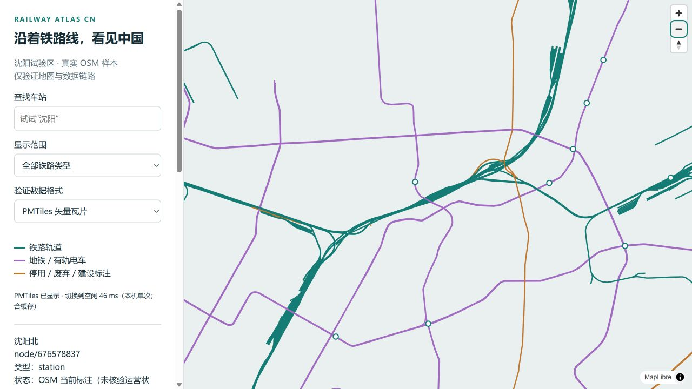

# 可行性报告 · 2026-10-22

## 结论

**可以采用 Rust 离线处理、MapLibre 地理地图和版本化静态瓦片的模式推进。**
真实沈阳数据已证明几何提取、Rust 转换、浏览器显示与按需瓦片读取可行。
这支持建设首个城市产品；全国资源、线上服务与移动端指标仍须逐阶段实测。
需求、设计与架构已据此定为 v1.0 基线，不依赖未经证实的“全 Rust/WASM 更快”假设。

## 1. 实验范围与输入

- 区域：西/南/东/北为 123.0 / 41.5 / 123.8 / 42.1，WGS84。
- 来源：Overpass 对 railway node/way 与生命周期 way 的有界查询，并返回引用节点。
- 源快照时间：2026-10-22 04:46:06 UTC，即北京时间 12:46:06。
- 原始 XML：4,707,967 字节，32,746 个 node、4,220 个 way、0 个 relation。
- XML SHA-256：`074eaa6b16703b580f83ca72051866996195cdde3c9da7352e2bb82408c76105`。
- 转换 PBF：298,663 字节；输入指纹与处理命令见 [manifest](../data/manifests/shenyang.json)。

Overpass 用于小范围探索；全国生产来源仍为日期锁定的中国 PBF。
本机尝试下载 Geofabrik 日期文件的 1 MiB range 时连接失败、收到 0 字节，
所以没有下载全国数据，也没有做全国 PBF 吞吐量测试。
该失败只说明本次执行环境连通性，不能推断数据源不可用或项目不可行。

## 2. 实测结果

| 实验 | 结果 | 证明范围 |
| --- | --- | --- |
| XML→PBF | Osmium 成功转换 | 真实 OSM 样本可进入 PBF 工具链 |
| 区域提取+铁路筛选 | 输出 4,220 ways，way 节点缺失 0 | 当前试验区几何引用完整，不证明 relation 完整 |
| 锁定 SHA-256 重跑 | region/railway 两份 PBF 均逐字节一致 | 同输入、配置、工具版本下可复现 |
| 错误输入指纹 | 明确拒绝且没有生成目标结果 | 防止把变化的 latest 当同一快照 |
| Rust release 读取与几何转换 | 10,692 features，4,220 way features，缺失引用 0 | Rust 路线可承担城市离线处理 |
| Rust 三次重复转换 | GeoJSON 指纹一致；内部耗时约 0.142–0.145 秒；进程墙钟约 0.191–0.196 秒 | 本机小样本，缓存/进程启动等口径分别记录 |
| Tippecanoe z8–14 | PMTiles v3，1,183,078 字节 | 标准瓦片链路成功，尚不证明全国体积 |
| 本机浏览器 GeoJSON | 10,692 要素可见；一次启动到地图空闲约 477 ms | 本机单次观测，无 WAN/手机/p95 结论 |
| 车站搜索、选择、详情 | 找到沈阳/沈阳北铁路及邻近地铁记录，选择后定位和详情正确 | 产品核心交互可实现 |
| PMTiles 切换 | 实际线路可见；多次请求返回 206；一次切换到空闲约 46 ms | 已先加载 GeoJSON 且可能命中缓存，不是冷热性能对比 |
| HTTP 头 | bytes 0–126 返回 206、Content-Range，魔数 PMTiles、版本 3 | 按字节读取的本机契约有效 |
| Rust 领域测试 | 生命周期前缀、未知/无关标签 2 项通过 | 基本分类规则，非正式全套语义验收 |
| 缺失节点反例 | 人工构造的 PBF 缺少 1 个引用节点；Rust 返回非零，未写出 GeoJSON/报告 | 不静默发布部分断裂几何 |
| 前端依赖审计 | 升级后 0 已报告漏洞 | 检查当时依赖数据库，不是永久安全保证 |

机器原始数据：[pilot-verification.json](evidence/pilot-verification.json)。
样本统计：[rust-pilot-v2.json](../data/manifests/rust-pilot-v2.json)。

## 3. 对产品设计有直接影响的发现

1. **物理轨道足够支持地理探索。** way 中 rail=3,577，subway=310，tram=173；
   还有废弃、停用、建设及其他设施。rail 不等于“国铁主线”，需要独立类型/用途规则。
2. **片段属性并不完整。** 全部 4,220 个 way 中，1,354 有 name（32.1%），
   769 有 maxspeed（18.2%），2,422 有 electrified（57.4%）。
   分母包含站区/设施等非轨道，不能把这些比例宣传为轨道网络覆盖率；足以说明应支持“未标注”。
3. **名称不能作为车站身份。** 沈阳铁路记录为 node/6179162407、沈阳北为 node/676578837；
   地铁分别有 node/13028356638 与 node/11224161741。附近另有 station way。
   合并需 relation/引用或审核证据；原始 station 记录数不等于独立车站数。
4. **轨道和运营线路不同。** 样本不含 relation，因此只能可靠做片段探索，
   不能从同名片段或站点名字生成完整运营线路与可用路由。
5. **静态瓦片可用，但并非任何场景都更小。** GeoJSON 原文 5,239,765 字节，
   gzip 545,511 字节；多缩放 PMTiles 为 1,183,078 字节。
   选择瓦片为了按视野读取和分级渲染，不据此声称全量传输一定更省。
6. **不需要先做 WASM。** 该样本已可交互；尚无浏览器计算瓶颈证据，
   更多收益首先来自合理数据量、图层与索引结构。

## 4. 候选模式比较

| 模式 | 适用 | 代价 | 决策 |
| --- | --- | --- | --- |
| 浏览器直读区域 GeoJSON | 快速样本与开发调试 | 加载和解析整个文件；全国扩展差 | 保留为调试模式 |
| Rust 离线+PMTiles+静态索引 | 只读地图、周期更新 | 需要构建、版本与 Range/CDN 检查 | 采用为 v1 主线 |
| Rust API+PostGIS 动态服务 | 跨区查询、实时变更、编辑 | 运维、数据库、服务成本 | 需求/性能门槛触发后引入 |
| Rust/WASM 浏览器计算 | 本地重计算与离线拓扑 | 编译体积、复制、工具链复杂度 | 当前没有引入依据 |

## 5. 仍未验证及其处理

全国原始文件、峰值 RAM、低缩放概览、跨区域拼接、路由关系、线上 Range/CORS/CDN、
真实手机、生产底图与公开地图条件均未验收。它们被明确编入 [实施门槛](implementation-plan.md)，
无需等待这些未来实现完成才形成当前需求与架构，但不能用本报告宣布全国产品已完成。

## 6. 原始来源与查阅日期

以下官方/原项目资料于 2026-10-22 查阅；实验数据和工具输出优先作为本次证据。

- [Geofabrik 中国下载](https://download.geofabrik.de/asia/china.html)：日期快照与生产输入来源。
- [Osmium extract](https://docs.osmcode.org/osmium/latest/osmium-extract.html)、
  [tags-filter](https://docs.osmcode.org/osmium/latest/osmium-tags-filter.html)、
  [check-refs](https://docs.osmcode.org/osmium/latest/osmium-check-refs.html)：裁剪、引用与检查边界。
- [OSM railway 标签](https://wiki.openstreetmap.org/wiki/Key:railway)：类型与生命周期标签解释。
- [Overpass API](https://wiki.openstreetmap.org/wiki/Overpass_API)：有界探索入口，非全国前端上游。
- [osmpbfreader](https://docs.rs/osmpbfreader/0.19.1/osmpbfreader/)：Rust PBF 与依赖读取接口。
- [MapLibre 大数据指南](https://maplibre.org/maplibre-gl-js/docs/guides/large-data/)：数据量与渲染策略。
- [PMTiles 概念](https://docs.protomaps.com/pmtiles/)、[MapLibre 集成](https://docs.protomaps.com/pmtiles/maplibre)：Range 与版本化瓦片方案。
- [Tippecanoe](https://github.com/felt/tippecanoe)：GeoJSON 到标准瓦片工具。
- [OpenRailwayMap](https://github.com/openrailwaymap/OpenRailwayMap)：同类基础设施地图参照；本次不复制其实现。
- [MapLibre 已知漏洞公告](https://github.com/advisories/GHSA-jrc7-96c5-q579)：放弃旧版探针依赖的依据。
- [OSM 版权与数据许可](https://www.openstreetmap.org/copyright)：数据署名与 ODbL。
